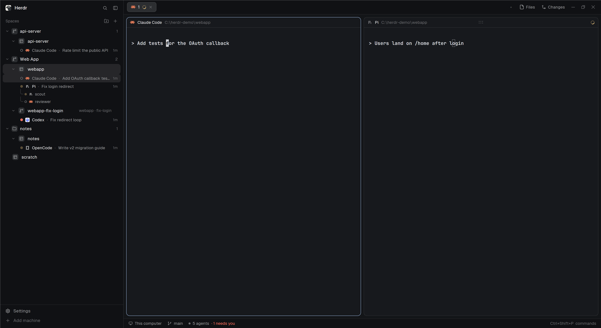

# Paddock

Herdr's Spaces sidebar, by project, with your agents in it. Spaces sit under the
project they work in, Orca-style: a git repository with its worktrees, or any
folder you add. Under each space are its agents, with a traffic light, the
session they're on and how long they've been in that state, and the sub-agents
they started.



A mod for the [Herdr](https://herdr.dev) desktop app. It replaces the shipped
`spaces` list; everything else in your window stays as it is.

## What it does

- **Projects.** A project is a folder on one machine. A git repository a space opens
  in becomes one by itself (its worktrees join it); **New project** (the folder-plus
  button by "Spaces" or by a machine) adds any folder, with a name. Projects stay
  when their spaces close, dimmed, so their **+** can open one again.
- **Which project a space is in:** its repository's, else the deepest project folder
  holding where it works now. Drag a space onto a project to put it there, or onto
  the dashed "Drop here to take it out of its project" zone to take it out.
- **A project's row:** fold it, drag it to reorder, **+** (on hover) for a new space
  in its folder, right-click for **New space here**, **Edit project…** (name and
  folder) and **Remove project** (the folder and its spaces stay). Folded, it shows
  a spinner when an agent inside works and a dot when one needs you or is done.
- **Agents under their space:** a light in the theme's status colors (needs you,
  done, working pulsing, a ring when idle), the program, its session (read from its
  terminal title as [herdr-session-titles](https://github.com/choam2426/herdr-session-titles)
  does: Pi, Claude Code and Codex tested; OpenCode from its source) and the time in
  that state. A click goes to the agent. Sub-agents hang under their parent with
  tree lines: those started as terminals with `hc run` (a click peeks at one), and,
  with the optional hooks below, those Claude Code and Codex run inside themselves
  (their type and time; a click goes to the parent). The chevron before a space
  folds its agents.
- **Pin** (the pin on a space's row, on hover) keeps a space at the top of its project.
- **One kind of tile** for every row: a project is a branch (a git repository) or a
  folder, a space a window in panes, a worktree a branch.
- **Moving from space-folders?** On first start, its folders become projects.

Machines stay apart, as in Herdr: each has its own section and its own projects.

## Install

Ask your Herdr agent: *"add the mod at github.com/choam2426/herdr-paddock"*. It reads
[RECIPE.md](RECIPE.md) and the files, copies the mod and points a copy of your layout
at it.

By hand:

1. Copy the mod (use `$HERDR_APP_HOME` instead of `~/.config/herdr-app` if you set
   it). If you already have a mod named `paddock`, give this one another folder name
   and change the name in two places too: `mod: "paddock"` in `overlay.js` (its menus
   and dialogs) and `mods/paddock/icons/` in `main.js` (the space icon).

   ```sh
   git clone https://github.com/choam2426/herdr-paddock
   cp -R herdr-paddock/mods/paddock ~/.config/herdr-app/mods/
   ```

2. Copy the layout you use (Herdr's own are read-only). For the default, `main`:

   ```sh
   herdr-app do layout.clone '{"name":"main","as":"main-paddock"}'
   ```

3. In `~/.config/herdr-app/layouts/main-paddock.json`, set the block whose
   `content.mod` is `spaces` to `paddock`.

4. Check: `herdr-app check ~/.config/herdr-app/mods/paddock`, then `herdr-app status`
   should show `"errors": []`.

To go back: `herdr-app do layout.switch '{"name":"main"}'`.

## Sub-agents of Claude Code and Codex (optional)

Claude Code and Codex run their sub-agents inside themselves, so Herdr doesn't see
them. Paddock shows them when their **hooks** tell it: on each sub-agent's start and
end, a small script puts or removes a label on the agent's own Herdr terminal
(`paddock.sub.<app>.<id>`), which Paddock reads. The sidebar works without them.

The hooks are registered **asynchronously**, so the agent never waits for them. The
scripts print nothing and always exit 0, so they can't block or change what the
agent does. They read the hook's event JSON from standard input and keep only the
event name, the session id, the sub-agent's id and type. They use no network and
open no file except, for Codex, its `session_index.jsonl` (to find the thread's
terminal, below). They run `hc` (and `jq` when it's there).

**Install** (ask the person first; an agent installing it does the same):

1. Back up the agent's config file.
2. Take `mods/paddock/hooks/claude.json` or `codex.json`, replace `<HOOKS>` with the
   absolute path of `mods/paddock/hooks` in forward slashes (for example
   `C:/Users/me/.config/herdr-app/mods/paddock/hooks` or
   `/home/me/.config/herdr-app/mods/paddock/hooks`; it follows `$HERDR_APP_HOME`).
3. Merge it: for each event, **append** its group at the end of that event's list in
   `~/.claude/settings.json` or `~/.codex/hooks.json` (`$CODEX_HOME` if set). Keep every
   existing group (another tool's hooks, such as Orca's) where it is. A group whose
   command contains `/paddock/hooks/subagents.` is Paddock's: update it in place
   instead of adding a second one.
4. Codex asks to trust new or changed hooks: open `/hooks` in Codex and trust the
   three. It trusts hooks by their position, so don't insert or remove a group in
   front of another one, or that one has to be trusted again.
5. Start a new session of the agent; sub-agents show from then on.

To remove them, delete Paddock's groups (the last in each list) and nothing else.

**How each agent runs them**

| | Windows | macOS, Linux |
|---|---|---|
| Claude Code | `sh` through Git Bash, which Claude Code uses on Windows | `sh` |
| Codex | `powershell.exe` (`commandWindows`; Git's `sh` isn't on Windows' own PATH) | `sh` through `$SHELL -lc` |

Codex usually runs hooks from its shared background server, which wasn't started in
a Herdr terminal, so the hook finds the terminal itself: the live Codex terminal whose
title holds the thread's name, else the only live Codex terminal in the session's
folder. When it can't tell (two Codex terminals in one folder on threads without a
name), it shows nothing rather than the wrong row. Running `codex --no-daemon` avoids
the guess.

## What it runs, reads and keeps

- As Herdr's own sidebar does: `git` in your spaces' folders (branch, ahead/behind,
  which repository) and `hc machine ls` every 15 seconds.
- `git rev-parse` in each project's folder, once and again every 10 minutes, to tell
  a repository from a plain folder. For a project on another machine, there.
- Adding or editing a project checks the folder: here by starting `git` in it, on
  another machine with `sh` there (which also expands `~`).
- On first start only, it reads `~/.config/herdr-space-folders.json` (the
  space-folders mod's file) if it exists, to turn its folders into projects.
- With the optional hooks: see the section above.
- No network. Projects are kept in Herdr's shared state (`paddock.projects`), per
  machine. Folds, pins and when each agent last changed state are kept in the mod's
  own storage; entries for spaces and agents that are gone are dropped.

## Limits

- It's a copy of Herdr 0.1.11's `spaces` mod, so later changes to Herdr's own sidebar
  don't reach it. [RECIPE.md](RECIPE.md) is written so an agent can rebuild it on
  your version.
- Run on Windows with Herdr 0.1.11, with Pi, Claude Code and Codex agents. macOS and
  Linux are untested; nothing in it is Windows-only (paths are compared the Windows
  way, ignoring case, only for drive-letter paths, so on macOS a folder typed in
  another case is another folder). On another machine, only the folder check was
  tried (on Linux).
- Projects live in this computer's Herdr, so another computer connected to the same
  machine has its own list.
- The sub-agent hooks were run end to end on Windows with Claude Code and Codex; on
  macOS and Linux only their script logic was tested here (with a stand-in `hc`).
  For an agent on another machine, the hooks and the scripts must be installed on that
  machine, with its paths; that hasn't been tried.
- A sub-agent whose end the hooks never see (the agent killed mid-run) shows until the
  agent's next session starts in that terminal, or for 12 hours. Only rows under a
  running agent of the same app show at all.
- With `-ExecutionPolicy Bypass` refused by a Group Policy, or PowerShell in constrained
  language mode, Codex's Windows hook does nothing (Codex isn't affected).

## Development

```sh
npm test    # projects, belonging, drag in and out, reordering, the space-folders import,
            # sub-agent trees and hook labels
```

## License

Apache-2.0, see [LICENSE](LICENSE) and [NOTICE](NOTICE). Derived from Herdr's shipped
`spaces` mod; one icon from [Lucide](https://lucide.dev) (ISC).
