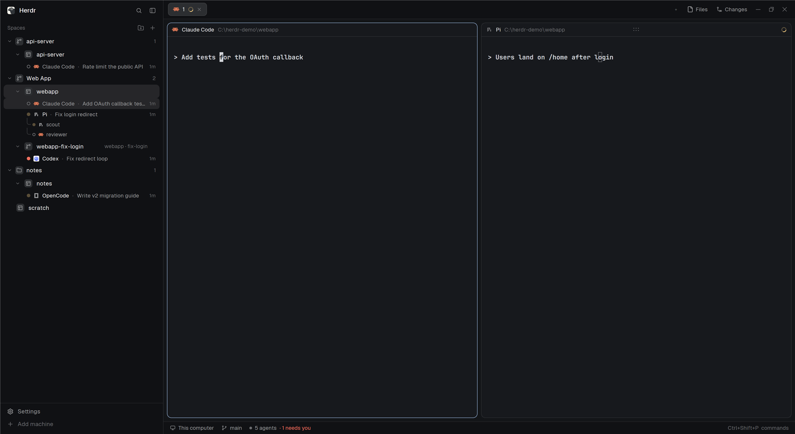

# Paddock

Herdr's Spaces sidebar, by project, with your agents in it. Each machine's spaces
sit under the project they work in, as Orca groups worktrees: a git repository
with its worktrees, or any folder added as a project. Projects stay when their
spaces close. Under each space are its agents, each with a traffic light, the
session it's on and how long it has been in that state, and under an agent the
sub-agents it started.

## What you see

The sidebar's spaces block, on the `chrome` background, base text 13px. Everything
not named here is Herdr's shipped `spaces` mod as it is.

- **Header**, 31px: "Spaces" (11.5px, `dim`), then two 26px buttons: folder-plus
  (New project) and `+` (a new space), each with a 14px icon and `hover` behind it.
- **Machine headers** (26px, 11px `dim`) appear, as in Herdr, once another machine is
  known: monitor or server icon, the name, then while it's connected a folder-plus
  (New project on it) and `+`, a connection dot and a chevron that folds the machine.
- **Every row has one kind of tile**: 18px, 5px corners, `raised` behind a 12px
  `muted` icon. A project is `git-branch` when its folder is in a git work tree and
  `folder` otherwise; a space is Lucide's `panels-top-left`; a worktree space is
  `git-branch`.
- **A project's row**, 28px, 7px corners, 8px side padding, 7px gaps: an 11px chevron
  (`dim`), its tile, its name (medium weight; `muted` while none of its spaces is
  open), then, folded, a 11px spinner in `working` when an agent inside works or a
  `●` in the status color when one is blocked or done; on hover a `+`; and the count
  of its spaces (11.5px, `dim`).
- **A space's row**, 30px, 8px corners: inside a project indented 18px (a worktree
  outside every project draws like any space, without tree lines); an 11px slot
  (the chevron folding its agents, or empty), its tile, the name (at most 150px), the
  shipped git tail (repo · branch ↑ahead ↓behind, 11.5px `dim`), and at the right
  end: while its agents are folded the same spinner or dot as a folded project, and a
  12px pin, always when pinned (`muted`), on hover otherwise (`dim`).
- **An agent's row** under its space, 24px, 6px corners, 12px text, indented so its
  light sits under the space's tile (51px in; 33px under a space outside a project):
  an 8px light, the
  program's 13px icon, its name (at most 110px; `muted` when idle), a `dim` `·` and
  the session (`muted`, truncated), and on the right the time in that state (`<1m`,
  `12m`, `3h`, `2d`; 11px `dim`). The focused agent's row is `selected`.
- **The lights**: blocked a filled `blocked` dot, done a filled `done` dot, working a
  `working` dot pulsing its opacity 0.35↔1 every 1.2 s, idle a 1.5px ring in `idle`
  (else `dim`).
- **A sub-agent's row**, 22px, 11.5px text, under its parent: tree lines (9px wide,
  1.5px `input` strokes, `└`/`├` with a 5px rounded corner), a 7px light, its 12px
  icon and its name (`muted`).
- **While a space is dragged** out of a project: below the list, a 34px dashed box
  (`border`, `accent` while over it) reading "Drop here to take it out of its project".
- **The project menu** (right-click), 200×112 popup on `popover`: 31px items with a
  14px `muted` icon: New space here (`plus`), Edit project… (`square-pen`), a 1px
  `border` line, Remove project (`x`). ↑/↓/Enter/Esc work.
- **New project / Edit project**, a 460px dialog on `popover`, 20px padding: the
  title, "Esc" in `dim`, a Name field (hint "Empty: the folder's name."), a Folder
  field with **Choose…** beside it on this computer (hint: what belonging means; on
  another machine "A path on <machine>, such as ~/code/app."), an error line in
  `blocked`, and Cancel / Add (or Save; "Checking…" while it checks).
- **The narrow rail** (sidebar under 160px): a project is its tile, centered, with its
  name as a tooltip; spaces are Herdr's numbers and dots.

## How it behaves

- **Projects** are kept per machine, in the sidebar's order, with the folders the
  person removed and the spaces they dragged in or out.
  - A space in a git repository not listed adds that repository's folder, named after
    it, unless the person removed it before.
  - New project adds a folder (here from the dialog, its Choose… using the system
    picker; on another machine typed and checked there). Its name defaults to the
    folder's name.
  - Edit project changes the name and the folder. A folder another project has is
    refused ("Another project has this folder."); the folder left behind counts as
    removed, so its repository doesn't come back by itself.
  - Remove project drops it (and spaces dragged into it); its folder counts as
    removed; adding it by hand again clears that.
  - On first start, before any project is kept, the space-folders mod's folders (its
    file in `~/.config`) that have a start path become projects, `~` expanded.
- **Belonging**: a space is in the project it was dragged into (`of`), out of all if
  dragged out (`""`), else in its repo's project (the git common dir's folder), else
  in the deepest project whose folder holds where it works now (its first terminal's
  live folder, else the space's folder). Paths compare with `/` for `\`, no trailing
  slash, and, for drive-letter paths only, ignoring case. Inside a project, main
  checkouts come before worktrees, pinned spaces before both; Herdr's order otherwise.
- **Repo or folder**: git is asked about each project folder, on its machine, once
  and again every 10 minutes (a minute after it couldn't be reached), each folder on
  its own. Until it answers, a project found from a repository, or holding a space in
  one, shows the branch.
- **Dragging**: press on a space and release on a project's row to put it there; on
  the dashed zone to take it out of its project (back to where its folder puts it if
  that's another project, else loose); on another space to move it there (Herdr's
  `space.move`) and into that space's project. Press on a project's row and release on
  another to reorder (a 2px `accent` line shows where). Only within one machine.
  Releasing anywhere else changes nothing.
- **Clicks**: a project's row folds it; its `+` and New space here run `space.new`
  with its folder (and machine); a space's row selects it; a space's chevron folds its
  agents; an agent's row runs `pane.focus` with its pane; a sub-agent's row runs
  `terminal.peek`; the pin pins. Right-click on a space opens Herdr's own space menu.
- **Agents** are Herdr's agents (those with a pane), under their space. The session
  is read from each agent's terminal title as herdr-session-titles does (Pi
  `π - <session> - <folder>`, Codex `<thread> | <project>`, Claude Code's title,
  OpenCode `OC | <session>`, nothing for Gemini CLI); without one the row shows the
  program alone. When each agent last changed state is kept (done counted as idle, as
  the Agents list does); the times redraw every 30 s while any agent row shows.
- **Sub-agents** are the live terminals an agent started, depth first, under it. An
  error counts as needing you and done as idle (a sub-agent reports to its parent).
- **Statuses** never change wording; a folded project or space shows its most urgent
  agent's (blocked > done > working > idle), from its spaces' own statuses or its
  agents'. Sub-agents don't count there.
- Folded projects, folded agent lists and pins are kept. Pins, folds, drags and times
  of spaces and agents that are gone are dropped, for a machine only while some of its
  spaces are listed (not while it loads or is away), as the Agents list prunes its pins.

## Built from

- `mods/paddock/`, `mod.json` `{ "place": "none", "title": "Spaces", "cloned_from":
  {"name": "spaces", "version": "0.1.11"} }`: `mod.clone {name: "spaces", as: "paddock"}`,
  then:
  - Storage: shared state `paddock.projects` = `{ [machine or ""]: { list: [{ id,
    root, name, auto }], removed: [root], of: { [spaceId]: projectId | "" } } }`; the
    mod's `localStorage`: `projects.folded`, `agents.folded`, `pins`, `changed`
    (address -> { s, at }), `imported`.
  - `main.js`: the clone, with a modified-file note at the top. `section()` groups a
    machine's rows into projects (and adds repos it meets, writing shared state only
    when it found one), `projectHead()`, `projectTile()`, `isRepo()`/`askRepos()`
    (`git -C <folder> rev-parse --is-inside-work-tree`, queued from `checkNew`'s
    250 ms tick), `place()`/`endDrag()` for dragging, `pinButton()`, `readAgents()`
    (each render: `agents()` grouped by `space`, `terminals()` by parent), `prune()`,
    `agentRows()`, `agentChevron()`, `agentStatus()`; the header and machine headers
    gain folder-plus buttons; Herdr's own `space.colors` upkeep stays (other mods read
    it) but tiles don't use it. The clone's machine grouping, git tails, worktree
    detection and `space.move` dragging are unchanged.
  - `projects.js` (no herdr imports, tested by node): `repoRoot`, `norm`, `inside`,
    `taken`, `addProject` (ids from the folder, made unique), `removeProject`,
    `editProject`, `reorderProject`, `placeSpace`, `prunePlaced`, `projectFor`,
    `naturalProject`, `groupRows`, `reposToAdd`, `urgent`, `fromSpaceFolders`.
  - `overlay.js`: the same mod opened as an overlay (`props().role`): "project-menu"
    (popup), "edit" and "add" (dialogs); `openMenu`, `openEdit`, `openAdd`; the store
    key `STORE = "paddock.projects"`. A folder is checked here by starting `git
    rev-parse --git-dir` in it (`exec` rejects when the folder is missing), and on
    another machine with `sh -c 'p=$1; case $p in "~"|"~/"*) p=$HOME${p#"~"};; esac;
    cd -- "$p" 2>/dev/null && pwd -P'`.
  - `agents.js` (draws): `agentRow`, `light`, `label`, `subRow`. `agents-data.js` (no
    herdr imports, tested): `duration`, `kidStatus`, `byParent`, `tree`.
  - `session.js`: herdr-session-titles' code, its header comment adapted.
  - `icons/panels-top-left.svg` (Lucide, ISC; `icons/LICENSE-lucide.txt`). Other icons
    are Herdr's `mods/workspace-chrome/` ones: `git-branch`, `folder`, `folder-plus`,
    `plus`, `square-pen`, `x`, `pin`, `chevron-down`/`right`, `spinner`, `monitor`,
    `server`.
- Layout: a copy of the person's layout with the block whose `content.mod` is
  `spaces` set to `paddock`.
- Herdr: `spaces`, `machines`, `panes`, `agents`, `terminals`, `run` (`space.new`,
  `space.select`, `space.move`, `pane.focus`, `terminal.peek`), `openOverlay`,
  `closeOverlay`, `shared`/`setShared`, `exec` (`git`, and `sh` on another machine),
  `hc` (`machine ls`, as shipped), `watchFolder` (as shipped), `readTextFile`,
  `pickFolder`, `home`, `props`, `theme`, `layout`, `window`. No network.

## Watch out

- The mod's own name is written in two places: `mod: "paddock"` in `overlay.js` (its
  menus and dialogs open the mod by name) and `mods/paddock/icons/` in `main.js`.
  `mod.clone` rewrites such names; a copy under another folder name must change both.
- Shared state written while rendering must be written only on a real change (a repo
  found, a placement pruned), never by comparing a fresh read: a write re-renders
  every mod.
- An element that starts a drag on mouse-down (a project row) must not swallow its
  own buttons: stop mouse-down on the `+`, the pin and the chevron, or pressing them
  starts a drag.
- The dashed drop zone is the only way out of a project: releasing on the empty list
  does nothing, so a slipped drag never moves a space.
- `flex_shrink()` takes a number in gpui-kit; `flex_shrink_1()` doesn't.
- Paths from git on Windows use `/` (`C:/work/app/.git`), terminals' use `\`: compare
  normalized. Only drive-letter paths ignore case; a Linux path is case-sensitive.
- `agents()` lists agents with panes only; sub-agents are in `terminals()`.
- A Herdr dialog over the window takes the keyboard: give the first field focus in
  `init` and again 600 ms later.
- Run on Windows with Herdr 0.1.11, Pi, Claude Code and Codex; on another machine only
  the folder check was tried (Linux). macOS and Linux are untested; nothing in it is
  platform-specific beyond the path rules above, which on macOS compare case exactly
  although its file system usually doesn't.

## Done when

- `herdr-app check` passes for the mod, `herdr-app status` shows `errors: []` with the
  layout using it, and `npm test` passes.
- A space opened in a git repository puts that repository in the list as a project
  with the branch tile; its worktree's space appears under it with the branch tile,
  after the main checkout.
- New project with a plain folder adds a folder-tile project; a space opened inside it
  appears under it; closing that space leaves the project, dimmed, with `+` on hover.
- Edit project onto another project's folder says "Another project has this folder."
- Dragging a loose space onto a project puts it there; dragging it onto the dashed zone
  takes it out; dragging one project's row onto another reorders them.
- Edit project renames a project; an empty name goes back to the folder's; Remove
  project drops it and its repository doesn't come back by itself.
- An agent in a space shows under it with its light, program, session and time; a
  click focuses it. A sub-agent started from it with `hc run` shows under it with tree
  lines; a click peeks at it.
- Folding a space's agents with its chevron shows the most urgent state on its row.
- Pinning a space moves it to the top of its project and keeps the pin shown.
